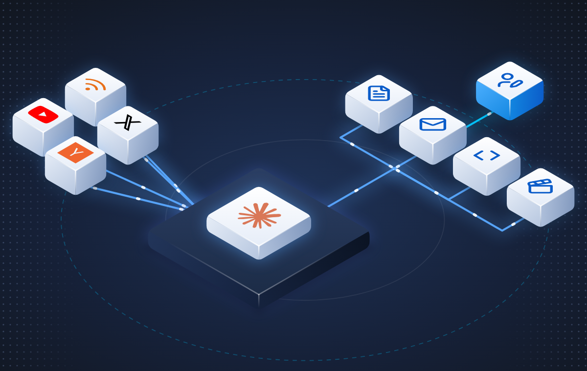
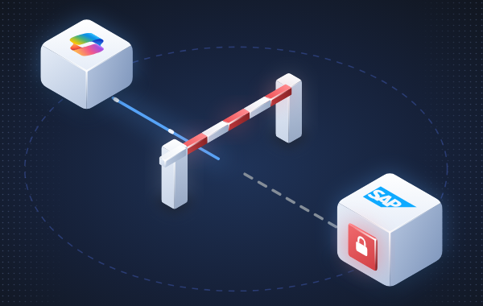

# isoscene

Polished isometric scenes as self-contained SVG, written from short Python scripts.



| | |
|---|---|
|  |  |

It drew the scenes and hero on [sigilant.io](https://sigilant.io) and the case-study picture on
[cisoai.au](https://cisoai.au/case-study).

## What you get

- Blocks with gradient faces, rounded edges, edge highlights and a coloured glow.
- Brand logos and [Lucide](https://lucide.dev) icons drawn onto the top faces.
- Glowing paths with pulses that move along them, and scan ripples (SVG animation, no JavaScript).
- A dark backdrop with rings and dots, or a transparent background.
- One SVG file per scene, with no external references. It plays its animation in an `` tag.

## Requirements

- Python 3.10 or later. No other packages.
- For previews only: Microsoft Edge or Google Chrome.

## Quick start

```sh
git clone https://github.com/cintelis/isoscene.git
cd isoscene
python examples/cisoai_case_study.py out/case.svg
python -m isoscene.preview out/case.svg out/case.png --phone
```

A scene of your own:

```python
import sys
sys.path.insert(0, r"C:\code\isoscene")   # or: pip install -e C:\code\isoscene
from isoscene import *

s = Scene()
s.ring(0, 0, 5.6, color="5B7CFA", op=0.30, dash="0.12 0.12")
s.path([(-4.0, 0.5, 0), (0, 0.5, 0)])                              # a glowing path with pulses
s.box(-5.0, 0, 0, 1.05, 1.05, 0.78, ICE, logo="claude", lw=0.66, r=0.14)
s.box(-1.8, -1.8, 0, 3.6, 3.6, 0.45, NAVY2, order=(0, 0), r=0.16, glow=0.25)
open("scene.svg", "w", encoding="utf-8").write(s.render())
```

Keep each scene script in the project that publishes the picture, so it can be re-run later.

## Documentation

[`SKILL.md`](SKILL.md) is the full guide:

- the workflow
- coordinates and how shapes are layered
- every function and colour set
- the logos and icons available
- the style rules that have worked

## Examples

| Script | Draws |
|---|---|
| `examples/sigilant_scenes.py OUTDIR` | The six sigilant.io scenes: shared key, register, blocked, kill switch, audit chain, discovery |
| `examples/sigilant_hero.py OUTDIR` | The sigilant.io hero, still and animated |
| `examples/cisoai_case_study.py OUT.svg` | The cisoai.au case-study picture |

## Preview

```sh
python -m isoscene.preview scene.svg [scene.png] [--width 1200] [--phone]
```

This renders the SVG to PNG with a local Edge or Chrome. `--phone` also saves a 390 px wide copy.
Set `ISOSCENE_BROWSER` to the browser's path if it isn't found.

## Tests

```sh
python tests/test_examples.py
```

This renders every example and checks that each SVG is well formed.

## Use as a Claude Code skill

The repository doubles as a skill. Link it into your skills folder, and Claude will use it when you
ask for an isometric picture:

```powershell
New-Item -ItemType Junction -Path "$HOME\.claude\skills\isoscene" -Target C:\code\isoscene
```

## Licence and third-party marks

Private. © Cintelis Pty Limited. The brand logos are trademarks of their owners; see
[`NOTICE.md`](NOTICE.md) for them and for the icon licences.
